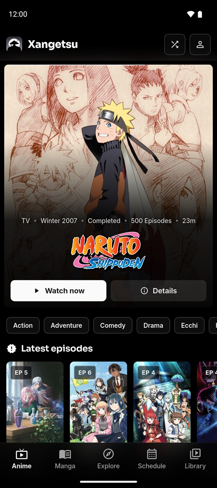
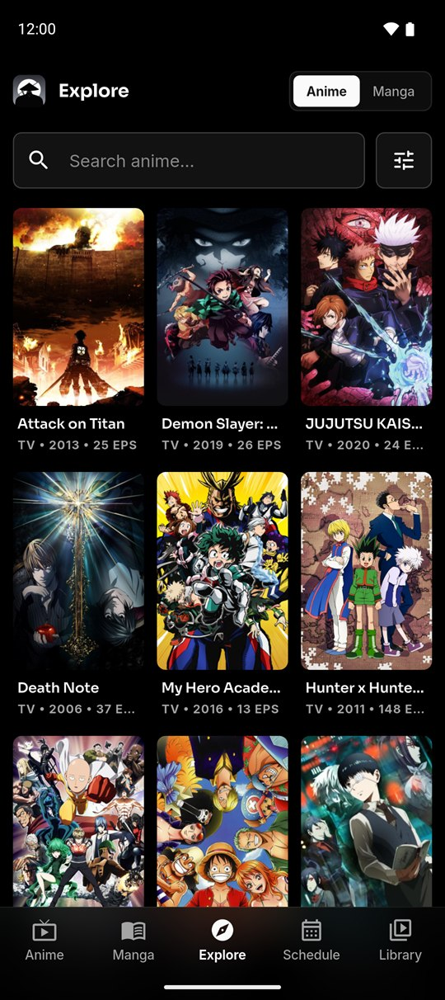
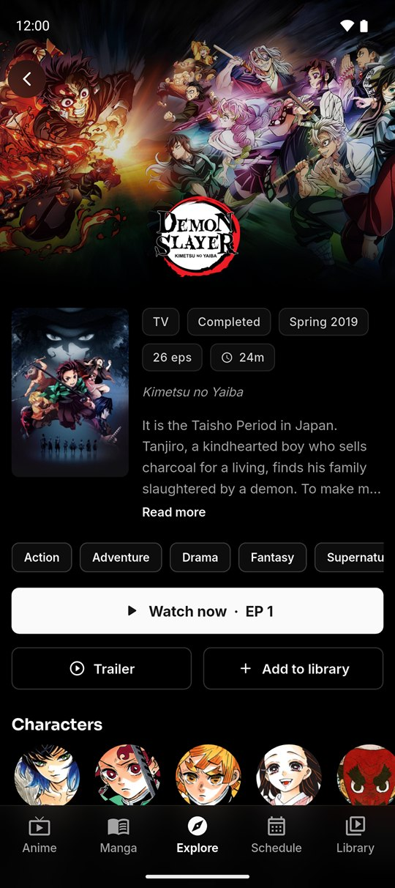
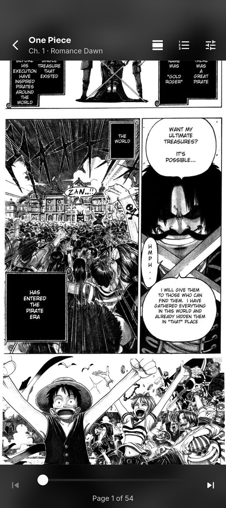

  

<h1 align="center">Xangetsu</h1>

  Watch anime and read manga online, or download them to enjoy offline. 
  Free for Android. No account needed.

  

  
  

  
  
  
  

## What you get

- **Anime and manga in one app**, with search, filters and a daily airing schedule.
- **Offline viewing.** Download episodes and chapters in the quality and language you want.
- **A player and reader made for your phone**, with gestures, subtitles, skip intro and picture-in-picture.
- **AniList and MyAnimeList sync** that updates your progress as you watch and read.
- **Built-in updates.** The app tells you when a new version is ready.

## Install

1. On your phone, open [projectjust.xyz/xangetsu](https://projectjust.xyz/xangetsu/) and tap **Download for Android**.
2. Open the file. If Android asks, allow installs from this source.
3. Tap **Install**.

Only download Xangetsu from projectjust.xyz. Copies from anywhere else could be modified.

## Help

Questions or problems? Ask on [Discord](https://discord.gg/P3yqksmGun) or [Reddit](https://www.reddit.com/r/ProjectJust/).
